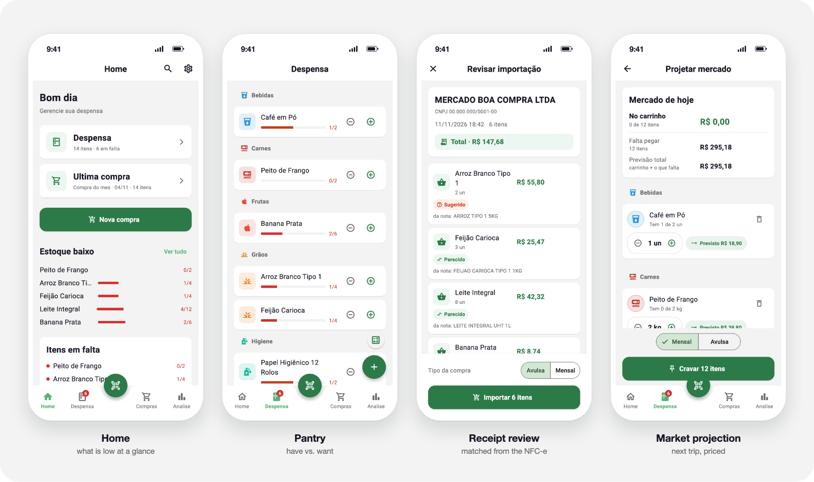
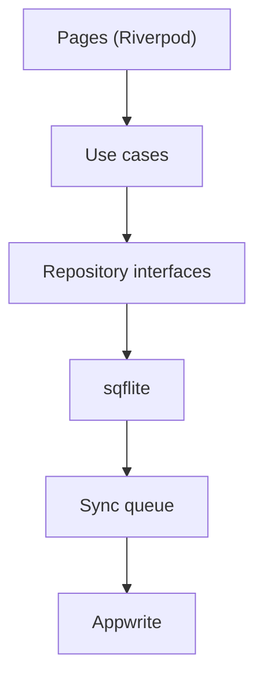
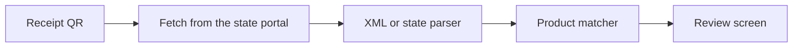

<p align="center">
  
</p>

<h1 align="center">Repooor</h1>

<p align="center"><b>Your pantry, restocked on time.</b><br>
Know what you have, what is running low and what the next trip to the market will cost.<br>
Scan the receipt and the purchase is already filled in.</p>

<p align="center"><sub>Flutter · iOS and Android · works offline after the first sign-in</sub></p>

<p align="center">
  
</p>

> [!NOTE]
> Repooor is not on the app stores yet. Receipt scanning reads Brazilian electronic receipts (NFC-e).

## What it does

- **Pantry with an ideal amount.** Each product has the quantity you have and the quantity you want. A colored bar shows what is low, and that gap drives the rest of the app.
- **Scan the receipt.** Point the camera at the QR code of an NFC-e. Repooor downloads the invoice from the state tax portal, matches each line to your products and shows a review screen: what matched, suggestions for the rest, and new products with a suggested category. Confirm and it becomes a purchase; finishing the purchase adds the quantities to the pantry.
- **Market projection.** Everything below its ideal amount, priced with what you paid last time, so you know what the trip will cost before you leave. Turn it into a shopping list, tick items off in the store, then compare the projection with the real receipt.
- **Shopping lists.** Monthly or one-off lists. Finishing a list updates the pantry.
- **Spending.** This month's spending by category, the products you buy most, how often you shop, and the price history of each product.
- **Offline, with a backup.** Data lives on the phone and the app keeps working without a connection. Your account backs it up to Appwrite; changes made offline wait in a local queue.
- **Portable.** Export and import everything as JSON. Product search and a built-in calculator.

## How it works





- **Clean Architecture.** Entities, repository interfaces and about 50 single-purpose use cases sit in `domain/`. Pages reach them through Riverpod; only `data/` knows about SQLite and Appwrite.
- **Receipts differ by state.** The state comes from the portal address in the QR, or from the invoice key. XML responses go to one generic parser, tested against a real invoice from Pernambuco. HTML pages go to a parser per state; Alagoas, Paraíba and Pernambuco exist, and only Pernambuco has been checked against the live portal.
- **Matching a receipt line to a product.** Receipt lines look like `ARROZ T1 5KG CAMIL`. The matcher removes accents and stray units, keeps measures such as `5kg`, singularizes, applies synonyms and only accepts prefix matches of four letters or more. Fuzzy similarity adds a small weight on top, so a new receipt lands on the products you already have instead of creating duplicates.
- **A queue that survives bad signal.** Every local write is recorded as an operation. A pusher sends the queue when there is a connection and tells permanent errors (kept and marked rejected) from transient ones (retried). On the first sign-in, data already on the phone is queued too.
- **Migrations that keep real data.** The schema is on its seventh version, built on a phone with real data. Some steps clean up as they migrate, merging duplicate products and removing orphaned items (`database_migrations.dart`).

## Getting started

Requires Flutter 3.38 and Dart 3.10.

```bash
git clone https://github.com/MikaelDDavidd/repooor.git
cd repooor
flutter pub get
flutter run \
  --dart-define=APPWRITE_ENDPOINT=https://your-appwrite/v1 \
  --dart-define=APPWRITE_PROJECT_ID=your-project-id
```

The app needs an Appwrite project for sign-in and backup. Without the `--dart-define` values it points to the author's server.

## Tests

```bash
flutter test
```

The screenshots above come from the app itself: `README_SCREENS=1 flutter test test/readme` renders the real pages with sample data and writes them to `build/readme_screens/`.

Over 500 tests in 74 files: use cases, repositories, the sync queue, the receipt parsers, models and widgets, plus checks that screens do not overflow on small phones and that touch targets meet the minimum size.

## Project structure

```
lib/
  core/           theme, routes, dependency injection, Appwrite config
  domain/         entities, repository interfaces, use cases
  data/           sqflite data sources and migrations, repositories,
                  nfce/ (QR decoder, parsers), matching/, sync/
  presentation/   home, pantry, purchase, nfce, projection, analytics,
                  search, settings, auth, onboarding
test/             mirrors lib/, plus fixtures/ with sample receipts
```

## License

MIT. See [LICENSE](LICENSE).
